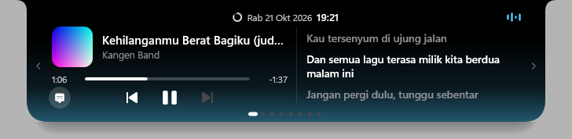
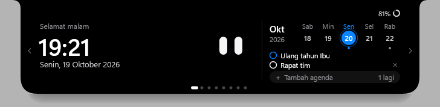
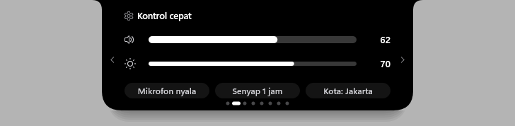

# NotchWindows

Notch ala MacBook untuk Windows: pemutar musik dengan lirik, kabar singkat ala Dynamic Island,
shelf file, kalender, dan widget kecil, di tengah atas layar. Ringan, berjalan lokal, tanpa akun.

*A MacBook-style notch for Windows. [English summary below.](#english)*





## Fitur

- **Musik**: sampul, judul, bar progres (bisa diseret untuk lompat), dan tombol putar untuk apa pun
  yang muncul di kontrol media Windows (Spotify, YouTube dan YouTube Music di browser, Media Player,
  dll.). Lirik tersinkron opsional, di pil dan di kolom lirik yang bergeser masuk. Geser dua jari di
  pil untuk pindah lagu.
- **Kabar singkat**: volume, kecerahan, charger dan baterai lemah, Bluetooth, Wi-Fi, Caps/Num Lock,
  unduhan selesai, screenshot baru, kamera/mikrofon mulai dipakai, dan pesan masuk (opsional).
- **Halaman panel**: Beranda (jam atau musik, plus kalender dan agenda), Kontrol cepat (volume,
  kecerahan, mikrofon, senyap), Shelf (seret file ke notch, atau ke zona Bagikan), Pomodoro, Timer,
  Minum air, Tugas, dan Sistem (CPU, GPU, RAM, disk, jaringan).
- **Tampilan**: animasi pegas, maskot yang melirik dan berekspresi, enam tema (termasuk Kaca dan
  Terang), tiga ukuran, menciut saat jendela di-maximize, sembunyi saat full-screen, dan tetap
  tampil di lock screen dengan isi terbatas.

Rincian tiap fitur ada di [catatan perubahan](CATATAN-PERUBAHAN.md).

## Pasang

Butuh Windows 10 versi 2004 atau lebih baru, atau Windows 11 (64-bit). Sejauh ini diuji di
Windows 11.

1. Unduh **notch.exe** dari halaman [Releases](../../releases).
2. Buka. Karena notch belum punya tanda tangan berbayar, Windows mungkin menampilkan
   *"Windows protected your PC"*: klik **More info → Run anyway**. Cara mengecek bahwa file itu
   asli ada di bagian [Keamanan](#keamanan).
3. Pilih **Ya** untuk memasang. Notch disalin ke `%LOCALAPPDATA%\Programs\NotchWindows` tanpa hak
   Administrator, muncul di menu Start, dan berjalan bersama Windows. Pilih **Tidak** untuk
   mencobanya sekali tanpa memasang.

Semua pengaturan ada di ikon maskot di system tray. **Perbarui**: unduh versi baru, buka, pilih Ya.
**Cabut**: Pengaturan Windows → Aplikasi → NotchWindows → Uninstall; notch menanyakan apakah datamu
(pengaturan, tugas, agenda) ikut dihapus.

### Pesan masuk (opsional)

Windows hanya mengizinkan aplikasi yang punya *identitas paket* membaca notifikasi. Untuk
menampilkan pesan WhatsApp, Telegram, dan aplikasi chat lain di notch, pilih menu tray →
Pengaturan → Pesan masuk → **Aktifkan pesan masuk…**, lalu setujui izin Administrator sekali.
Notch lalu:

1. membuat paket kecil berisi nama dan logo notch saja (tanpa program),
2. membuat kunci tanda tangan baru dan sertifikat "NotchWindows Pribadi" di komputer ini, lalu
   menandatangani paket itu,
3. **langsung menghapus kunci tanda tangannya**, jadi sertifikat itu tidak bisa dipakai
   menandatangani apa pun lagi,
4. memercayai sertifikat itu (hanya bagian publiknya) supaya Windows menerima paketnya, mendaftarkan
   paketnya untuk akunmu, lalu memulai ulang notch.

Setelah itu Windows menanyakan izin membaca notifikasi. Pilih jenis pesannya di menu yang sama.
Saat notch dicabut, paket dan sertifikat ini ikut dibuang.

## Privasi

- Tidak ada akun, telemetri, iklan, atau data yang dikirim diam-diam.
- Data notch berupa file teks biasa di `%APPDATA%\NotchWindows`, bisa dibaca dengan Notepad.
- Internet hanya dipakai dua fitur yang **mati secara default**:
  - **Lirik** dari [LRCLIB](https://lrclib.net): judul, artis, album, dan durasi lagu yang sedang
    diputar. Judul video YouTube dirapikan dulu (misal tanpa "(Official Music Video)").
  - **Cuaca** dari [Open-Meteo](https://open-meteo.com): nama kota yang kamu ketik (sekali), lalu
    koordinat pusat kota itu tiap 30 menit. Lokasi komputer tidak pernah dibaca.
- Pesan masuk dibaca dari notifikasi Windows di komputermu sendiri; tidak disimpan dan tidak dikirim
  ke mana pun. "Sembunyikan isi pesan" dan mode rapat menyembunyikan isinya.
- Kamera dan mikrofon tidak pernah dinyalakan; notch hanya melihat aplikasi mana yang sedang
  memakainya. Dari keyboard, notch hanya memperhatikan Caps Lock dan Num Lock.
- Log error (`log.txt` di folder data) hanya berisi jenis kegagalan, tanpa isi pesan, judul lagu,
  atau nama file.

## Keamanan

- Kodenya terbuka. Dependensinya hanya crate resmi Microsoft ([windows-rs](https://github.com/microsoft/windows-rs)).
- Setiap rilis dibangun oleh GitHub Actions dari kode di repo ini (lihat `.github/workflows/rilis.yml`),
  bukan diunggah dari komputer pribadi. Cek keasliannya dengan `SHA256SUMS.txt` di halaman rilis,
  atau dengan GitHub CLI:

  ```bash
  gh attestation verify notch.exe -R rthoriq/moord_notch
  ```

- Langkah Administrator untuk pesan masuk tidak membaca file atau masukan apa pun dari luar.
  Paketnya dibuat dan ditandatangani di folder Temp milik Windows, yang tidak bisa diubah program
  biasa, baru kemudian disalin ke folder pemasangan.
- Menemukan celah keamanan? Laporkan lewat *Security → Report a vulnerability* di repo ini, jangan
  lewat issue publik.

## Build sendiri

Butuh [Rust](https://rustup.rs) (versinya dikunci di `rust-toolchain.toml` dan dipasang otomatis
oleh rustup) dan Visual Studio Build Tools dengan workload C++ (termasuk Windows SDK).

```bash
cargo build --release
```

Hasilnya `target\release\notch.exe`. Jalankan dengan `--pasang` untuk memasangnya tanpa dialog.
`build.rs` menanam manifest, ikon, dan info versi ke exe.

```bash
cargo test
```

`cargo test` juga merender semua bentuk notch ke `target\preview\*.bmp`, untuk dicek tanpa
menjalankan aplikasi.

Untuk pengembang:

- Setelah build baru, klik dua kali `packaging\update.cmd` untuk memperbarui notch yang terpasang.
- Build debug (`cargo run`) membuka konsol berisi log. Pemasangnya bisa diuji tanpa menyentuh
  pemasangan sungguhan dengan variabel lingkungan `NOTCH_INSTALL_ROOT=<folder uji>`.
- `notch.exe --cek-notifikasi` menulis status izin dan daftar notifikasi yang dilihat notch ke
  `%TEMP%\notch-cek-notifikasi.txt`, tanpa isi pesan dan nama pengirim.

## Struktur kode

| File | Isi |
|---|---|
| `src/main.rs` | Titik masuk: perintah pasang/cabut/identitas, DPI awareness, cegah dua salinan berjalan |
| `src/app.rs` | Jendela, input mouse/keyboard, timer, loop pesan, perpindahan bentuk dan halaman |
| `src/render/mod.rs` | Gambar notch dengan Direct2D (software) ke layered window, alat gambar dasar, ikon |
| `src/render/pages.rs` | Tata letak pil, HUD, sambutan, dan tiap halaman panel; area klik didaftarkan sambil menggambar |
| `src/widgets/` | Data dan aturan shelf, pomodoro, timer, minum air, tugas, agenda kalender, serta urutan halaman |
| `src/install.rs` | Pasang, perbarui, dan cabut tanpa Administrator; catatan di Pengaturan > Aplikasi |
| `src/identity.rs` | Paket identitas untuk pesan masuk: dibuat, ditandatangani, dipercaya, didaftarkan |
| `src/log.rs` | Log error lokal |
| `src/store.rs` | Simpan/muat file teks di `%APPDATA%\NotchWindows` |
| `src/dragdrop.rs` | Seret file masuk/keluar, buka file, tampilkan di Explorer |
| `src/thumbnail.rs` | Thumbnail file dari Windows, di thread terpisah |
| `src/anim.rs` | Animasi pegas |
| `src/desktop.rs` | Deteksi full-screen dan jendela maximize lewat event Windows |
| `src/services.rs` | Thread latar untuk layanan WinRT/COM, kabar ke jendela lewat channel |
| `src/media.rs` | Sesi media Windows (SMTC), sampul album, perintah putar dan lompat |
| `src/audio.rs` | Volume speaker dan bisu mikrofon default: pantau dan ubah |
| `src/brightness.rs` | Atur kecerahan layar laptop lewat WMI |
| `src/power.rs` | Charger, persen baterai, dan kecerahan layar |
| `src/bluetooth.rs` | Perangkat Bluetooth tersambung/terputus dan baterainya |
| `src/privacy.rs` | Aplikasi yang sedang memakai kamera (Media Foundation) dan mikrofon (Core Audio) |
| `src/messages.rs` | Pesan masuk dari notifikasi aplikasi chat (butuh identitas paket) |
| `src/sound.rs` | Bunyi notifikasi bawaan Windows, diam saat full-screen atau Jangan Ganggu |
| `src/lyrics.rs` | Lirik tersinkron dari LRCLIB (opsional), perapian judul YouTube, pembaca format LRC |
| `src/weather.rs` | Cuaca dan pencarian kota dari Open-Meteo (opsional) |
| `src/http.rs` | HTTPS GET lewat WinHTTP dengan pemeriksaan sertifikat penuh |
| `src/share.rs` | Jendela Bagikan Windows untuk file yang dilepas di zona Bagikan |
| `src/sysinfo.rs` | CPU, GPU (beban dan suhu), RAM, disk, dan jaringan |
| `src/folders.rs` | Pantau folder Screenshots dan Downloads untuk file baru yang selesai ditulis |
| `src/network.rs` | Status Wi-Fi tersambung/terputus |
| `src/settings.rs` | Pengaturan yang diubah lewat menu tray |
| `src/tray.rs` | Ikon dan menu tray |
| `src/autostart.rs` | "Mulai bersama Windows" lewat kunci `Run` milik pengguna (tanpa admin) |
| `src/clock.rs` | Jam, tanggal, durasi, dan lama menyala berbahasa Indonesia |
| `build.rs`, `packaging/` | Manifest exe, ikon, manifest paket identitas, dan skrip pembaruan untuk pengembang |

## Target performa

RAM saat diam di bawah 40 MB, CPU saat diam sekitar 0%, terbuka kurang dari 1 detik. Notch hanya
menggambar saat ada yang bergerak; selebihnya proses tidur menunggu event. Saat musik diputar,
gelombang di pil digambar ulang sekitar 12 kali per detik, tapi hanya kotak kecil di sekitarnya
(sekitar 10 ms CPU per detik). Selama panel pemutar terbuka, panel penuh hanya digambar ulang saat
detik lagu atau baris lirik berganti (sekitar 15 ms CPU per detik). Pemantau folder dan Wi-Fi tidur
sampai Windows mengabari ada perubahan.

## Lisensi dan terima kasih

[MIT](LICENSE). Terinspirasi notch buatan Nusa dan aplikasi notch di Mac (Boring Notch, NotchDrop,
NotchNook). Lirik dari [LRCLIB](https://lrclib.net), cuaca dari [Open-Meteo](https://open-meteo.com).

## English

NotchWindows puts a MacBook-style notch at the top center of your Windows screen: a music player
with synced lyrics (also for YouTube and YouTube Music in the browser), Dynamic Island-style
notifications (volume, brightness, battery, Bluetooth, Wi-Fi, downloads, camera/mic in use,
optional chat messages), a file shelf with a Share zone, a calendar with your own agenda, and small
widgets (quick controls, pomodoro, timer, water reminder, tasks, system monitor). The interface is
in Indonesian.

- **Install**: download `notch.exe` from [Releases](../../releases), open it (if SmartScreen warns,
  choose *More info → Run anyway*), and choose *Ya* (Yes). No administrator rights are needed;
  uninstall from Windows Settings → Apps.
- **Privacy**: no account and no telemetry. Data stays in `%APPDATA%\NotchWindows`. Only two
  features use the internet and both are off by default: lyrics (LRCLIB) and weather (Open-Meteo).
- **Chat messages** (optional): Windows only lets packaged apps read notifications, so the tray menu
  offers a one-time administrator step. Notch creates a small identity package containing no
  program, signs it with a new local certificate, deletes the signing key immediately, and trusts
  the certificate so Windows accepts the package.
- **Verify a release**: `gh attestation verify notch.exe -R rthoriq/moord_notch`.
- **Build**: Rust (pinned in `rust-toolchain.toml`) and Visual Studio Build Tools with the C++
  workload, then `cargo build --release`.
